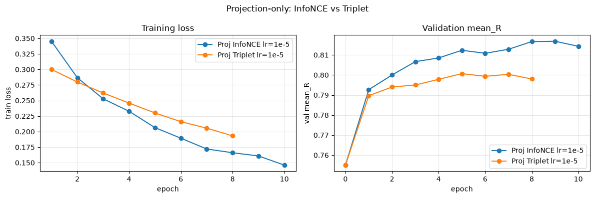
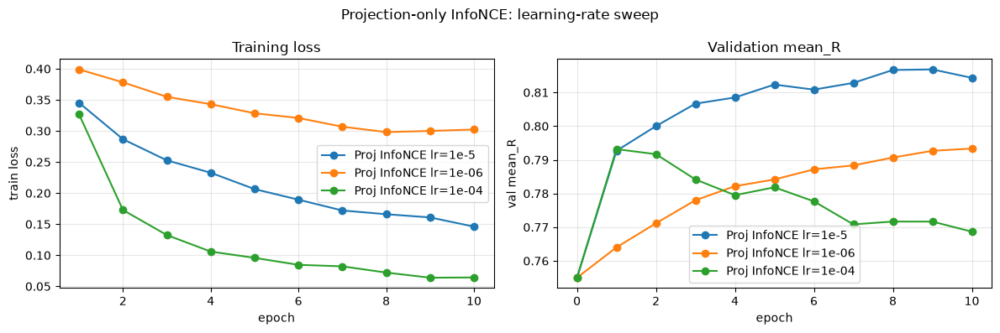
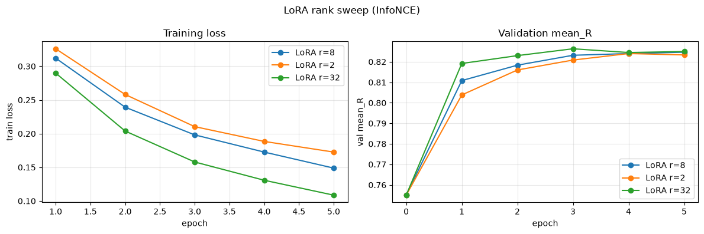
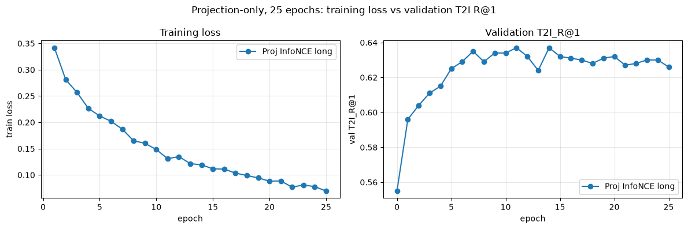
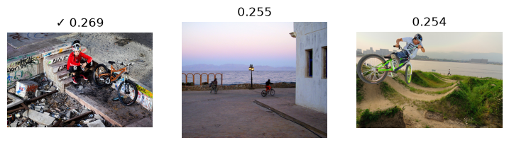
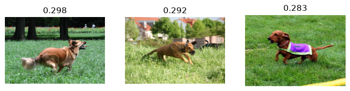

# Part 2 — Member D results

Completed on 2 November 2026 (Asia/Singapore), from merged main commit `ee1f94705af9dee55071e7d1bac36f9f6f3029c6`, on branch `codex/part2-d-results`.

All 29 code cells ran in order in one fresh Python kernel on Apple MPS. The supplied code and all eight training configurations were preserved. The notebook contains saved outputs and D’s answers to Q1, Q3, Q4 and Q6. B’s Q2/Q5 remain for B; the measurements and figures below support that handoff.

## Final test results

LoRA rank 32, selected on validation, achieved the highest recall in all six test metrics. Mean recall improved by **6.89 percentage points** over zero-shot and **1.19 points** over projection-only InfoNCE. Values below are percentages; `mean_R` is the unweighted mean of the six recalls.

| Method | I2T R@1 | I2T R@5 | I2T R@10 | T2I R@1 | T2I R@5 | T2I R@10 | Mean recall |
|---|---:|---:|---:|---:|---:|---:|---:|
| Zero-shot | 52.98 | 81.30 | 89.37 | 53.80 | 79.19 | 88.82 | 74.24 |
| Projection-only, triplet | 58.57 | 84.88 | 92.03 | 58.85 | 85.79 | 92.30 | 78.74 |
| Projection-only, InfoNCE (lr=1e-05) | 61.69 | 86.62 | 93.40 | 58.11 | 86.34 | 93.49 | 79.94 |
| LoRA r=32 + projections (merged) | 62.24 | 88.18 | 95.42 | 59.95 | 87.17 | 93.86 | 81.13 |

Projection-only InfoNCE is better than triplet on five recalls and their mean, but triplet has higher T2I R@1 (58.85% versus 58.11%). These are single-run results, not evidence of statistical significance.

## Validation choices and training records

| Run | Epochs completed | Best epoch | Best validation mean recall | Train-call seconds |
|---|---:|---:|---:|---:|
| Proj InfoNCE lr=1e-5 | 10 | 9 | 81.68% | 6.46 |
| Proj Triplet lr=1e-5 | 8 | 5 | 80.07% | 4.85 |
| Proj InfoNCE lr=1e-06 | 10 | 10 | 79.33% | 5.59 |
| Proj InfoNCE lr=1e-04 | 10 | 1 | 79.32% | 5.98 |
| Proj InfoNCE long | 25 | 11 | 81.72% | 15.54 |
| LoRA r=8 | 5 | 5 | 82.47% | 119.33 |
| LoRA r=2 | 5 | 4 | 82.40% | 112.18 |
| LoRA r=32 | 5 | 3 | 82.63% | 119.50 |

The selected projection learning rate is **1e-5**, using epoch **9**. The selected LoRA rank is **32**, using epoch **3**, with projection lr=1e-5, adapter lr=1e-4, alpha=64 and dropout=0.05. Rank selection used validation only; only the selected rank was tested. The 25-epoch projection run is diagnostic and was excluded from the final candidates.

Each recorded train-call time includes epoch-0 validation, training, subsequent validation, and best-weight restoration, with device synchronization at the measurement boundaries. It excludes model loading and checkpoint export. The notebook’s supplied “done in” time excludes epoch-0 validation and is rounded, so the two timings differ slightly.

## Overfitting and early stopping

The diagnostic reaches its highest validation mean recall at epoch **11** (81.72%), then ends at **81.00%** at epoch 25 while loss falls from 0.1310 to 0.0695. This supports mild overfitting after the validation peak.

Applying the actual strict-improvement patience-3 rule chronologically would stop at epoch **10**, restore epoch **7**, and save **15 epochs**. Epoch 9 merely ties epoch 7; it does not reset patience. This earlier stop would miss the later epoch-11 peak. The plotted T2I R@1 peaks at epochs 11 and 14; checkpoint selection uses mean_R.

## Merge and parameter evidence

All seven validation metrics, including mean_R, were identical before and after merging the 24 selected LoRA adapters.

The supplied single encoding measurements were 1.422 s unmerged and 1.185 s merged. These are approximate: the provided timing code has no explicit MPS synchronization or repeated benchmark. They do not establish a reliable speedup.

| Configuration | Adapter parameters | Total trainable parameters |
|---|---:|---:|
| Projection only | 0 | 655,360 |
| LoRA r=2 + projections | 49,152 | 704,512 |
| LoRA r=8 + projections | 196,608 | 851,968 |
| LoRA r=32 + projections | 786,432 | 1,441,792 |

All eight saved checkpoints passed CPU checks for finite tensors, exact parameter keys/shapes/counts and matching manifest hashes. The optional PEFT comparison confirmed the rank-8 adapter count of 196,608.

## Qualitative examples

**T2I success:** test position 1, dataset row 6535: “A cyclist sits on some steps with his bike.” The correct image is ranked first (0.2693); the other two leading images show different cycling situations.

**T2I failure:** test position 0, dataset row 2116: “A brown dog is running on the grass.” The designated image ranks fifth (0.2814), behind similar brown-dog/grass scenes. This illustrates instance ambiguity under a single-positive metric: it fails R@1 but succeeds at R@5.

The examples were selected by T2I R@1. Their reverse I2T ranks differ: the cyclist’s own caption is third, and the dog’s is second. See `qualitative.json` and the full-resolution ground-truth/retrieved PNGs for the exact rows, captions and scores.

## Protocol and reproducibility

- Data: 6,000 train / 1,000 validation / 1,091 test pairs, seed 42. Splits were verified complete and disjoint. Training uses the supplied batch size 64 and drop_last=True.
- All choices were fixed on validation before the single four-method test comparison. The later test encoding was used only for the prescribed qualitative examples; it did not change any choice.
- Cache shapes/finiteness were checked; five spread-out image rows matched the live encoder exactly. The provided cached-text check passed on 256 validation pairs.
- The supplied Recall@K convention counts candidates with strictly greater similarity; equal scores share the best tied rank.
- The shared DataLoader has its own seeded generator, which advances between runs even though run() resets global seeds. Experiment order is preserved; these runs do not use identical minibatch orders. No repeat-seed variation or confidence interval was measured.
- Python 3.12.16; torch 2.14.1; transformers 5.21.0; datasets 5.1.0; device mps.
- Frozen model revision: `3d74acf9a28c67741b2f4f2ea7635f0aaf6f0268`. Dataset fingerprint, split indices, cache hashes and source commit are recorded in the JSON artifacts.
- The execution helper only captured timing and saved weights; it did not change the supplied training or evaluation computations. Transient progress widgets were removed from saved outputs; metrics, plots and images were retained.

## Files and handoff

- [Executed notebook and D answers](../../Part_2.ipynb)
- [All results and histories](results.json), [validation table](validation.csv), [test table](test.csv), [per-epoch CSV](histories.csv)
- [Early-stopping calculation](early_stopping.json), [training configuration/timing](training_runs.json)
- [Provenance](provenance.json), [split indices](splits.json), [execution record](execution.json), [supplementary checks](supplementary_checks.txt)
- [Checkpoint manifest](checkpoint_manifest.json); eight local weight files are in `../../checkpoints/part2-d/` (Git-ignored).

Checkpoints contain **unmerged trainable parameter state dictionaries**, not full CLIP models or optimizer-resume snapshots. To restore, load the pinned frozen CLIP revision, apply the projection/LoRA setup specified in the manifest, wrap in RetrievalCLIP, then load the state with strict=False (frozen keys are intentionally absent). Check that there are no unexpected keys and that all trainable keys are present. Merge only after loading. Share these local weight files separately if another machine needs them.

B can use the loss curves for Q2 and the rank/parameter/merge measurements for Q5. C can use the qualitative failure for video Q12. D’s methodology, selected results and caveats are ready for video Q7/Q10/Q11; Part 1 evidence for the combined methodology discussion remains a separate handoff.
